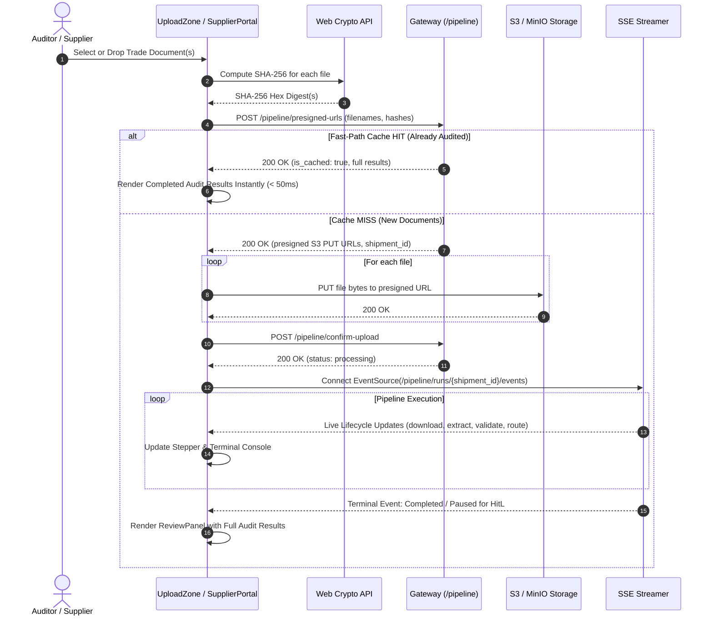
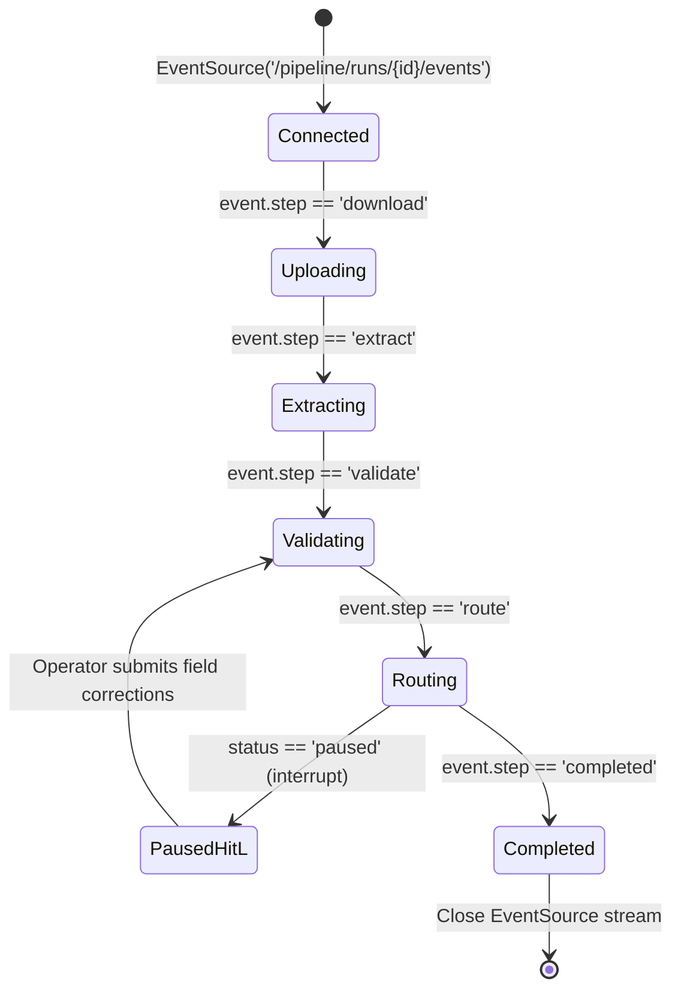

# Nova Logistics Audit — Frontend Web Client

A modern, high-performance React application serving as the interactive audit desk and supplier portal for the **Trade Document Validator** platform.

Built with **React 19**, **TypeScript**, **Vite**, and **Tailwind CSS v4**, this dashboard enables customs brokers and trade compliance auditors to monitor automated multi-agent extraction, review policy violations, reconcile cross-document discrepancies, perform human-in-the-loop (HitL) overrides, simulate supplier email submissions, and query historical pipeline data using natural language.

---

## Table of Contents

- [Key Features & Capabilities](#key-features--capabilities)
- [Frontend Architecture](#frontend-architecture)
  - [Component & Data Flow Architecture](#component--data-flow-architecture)
  - [Client-Side Fast-Path Upload Flow](#client-side-fast-path-upload-flow)
  - [Real-Time SSE Event Handling](#real-time-sse-event-handling)
- [Workspace Views & Pages](#workspace-views--pages)
  - [1. Audit Desk (`AuditDesk.tsx`)](#1-audit-desk-auditdesktsx)
  - [2. Supplier Portal (`SupplierPortal.tsx`)](#2-supplier-portal-supplierportaltsx)
  - [3. Run Registry (`HistoryRegistry.tsx`)](#3-run-registry-historyregistrytsx)
  - [4. NL Query Assistant (`NLQueryAssistant.tsx`)](#4-nl-query-assistant-nlqueryassistanttsx)
  - [5. Navigation Sidebar & Rules Inspector (`SideBar.tsx`)](#5-navigation-sidebar--rules-inspector-sidebartsx)
  - [6. Analytics KPI Cards (`AnalyticsCards.tsx`)](#6-analytics-kpi-cards-analyticscardstsx)
- [Directory Layout](#directory-layout)
- [Client-Side Innovations](#client-side-innovations)
  - [Zero-Cost SHA-256 Fast-Path Deduplication](#zero-cost-sha-256-fast-path-deduplication)
  - [Direct Client-to-S3 Streaming with Gateway Fallback](#direct-client-to-s3-streaming-with-gateway-fallback)
  - [Human-in-the-Loop (HitL) Interactive Overrides](#human-in-the-loop-hitl-interactive-overrides)
- [Tech Stack](#tech-stack)
- [Local Development & Setup](#local-development--setup)
- [Production Deployment (Docker & Nginx)](#production-deployment-docker--nginx)

---

## Key Features & Capabilities

* **⚡ Client-Side Pre-Hashing (Web Crypto API):** Calculates deterministic SHA-256 hashes in the browser before sending bytes over the wire. If the document packet was previously audited, the system provides an instant compliance decision in **< 50ms**, completely skipping S3 uploads and LLM agent queues.
* **🚀 Direct-to-S3 Presigned Streaming:** Streams multi-megabyte PDF and image documents directly to object storage (AWS S3 or MinIO) using presigned HTTP PUT URLs, eliminating backend API transfer bottlenecks.
* **📡 Real-Time SSE Progress Tracking:** Connects to backend Server-Sent Events (`/pipeline/runs/{id}/events`) via native `EventSource`. Renders a multi-stage animated stepper (`Upload` -> `Extract` -> `Validate` -> `Route` -> `Complete`) with live terminal log streaming.
* **🔍 Multi-Document Audit Inspector:** Displays multi-tabbed views for shipment packets (Commercial Invoice, Bill of Lading, Packing List) showing:
  * Field-level extraction with confidence badges and document snippet citations.
  * Deterministic compliance rule checks (pass/fail badges, expected vs. actual values).
  * Cross-document consistency matrix identifying mismatches across files.
* **✍️ Interactive Human-in-the-Loop (HitL) Editing:** Allows compliance auditors to correct low-confidence fields or override values directly in the UI. Submitting changes re-enqueues the shipment into the validation engine for immediate verification.
* **✉️ Supplier Outbox Simulation:** Interactive console allowing operators to simulate supplier email submissions with multi-file attachments, feeding the incoming processing inbox.
* **💬 Natural Language Query Assistant:** Enables plain-English questions (e.g., *"How many shipments failed Incoterms validation?"*) with instant SQL query rendering, table visualization, and synthesized executive answers.

---

## Frontend Architecture

### Component & Data Flow Architecture

```mermaid
flowchart TD
    subgraph UI ["🖥️ React 19 Frontend Client (Tailwind CSS v4)"]
        Sidebar["Navigation Sidebar\n& Active Rules Inspector"]
        Analytics["KPI Analytics Cards\n(Approval %, Latency, Hits)"]

        subgraph Pages ["Workspace Views"]
            Desk["Audit Desk\n(Queue / Upload / Review)"]
            Supplier["Supplier Outbox Console\n(Email Simulator)"]
            Registry["Run Registry\n(Historical Audit Log)"]
            NLQuery["NL Query Assistant\n(Natural Language to SQL)"]
        end

        subgraph AuditComponents ["Audit Desk Sub-Components"]
            UploadZone["Upload Zone\n(Web Crypto SHA-256)"]
            Tracker["Pipeline Stepper\n& Live Terminal Log"]
            ReviewPanel["Review Panel\n(Fields, Cross-Doc, Amendments)"]
        end
    end

    subgraph BrowserAPI ["🌐 Browser APIs"]
        WebCrypto["Web Crypto API\n(crypto.subtle.digest SHA-256)"]
        EventSource["Native EventSource\n(Server-Sent Events)"]
    end

    subgraph Gateway ["⚡ Backend API Gateway (/pipeline)"]
        PresignedAPI["/pipeline/presigned-urls"]
        ConfirmAPI["/pipeline/confirm-upload"]
        SSEEndpoint["/pipeline/runs/{id}/events"]
        ReviewAPI["/pipeline/update-status/{id}"]
        QueryAPI["/pipeline/query"]
    end

    subgraph S3Storage ["🪣 Object Storage (AWS S3 / MinIO)"]
        DirectPUT["Presigned S3 PUT URL"]
    end

    %% Bindings
    UploadZone --> WebCrypto
    UploadZone -->|"1. Pre-hash & Request Presigned URL"| PresignedAPI
    UploadZone -->|"2. Direct Binary PUT"| DirectPUT
    UploadZone -->|"3. Confirm Verification"| ConfirmAPI

    Tracker --> EventSource
    EventSource <-->|"Live SSE Stream"| SSEEndpoint

    ReviewPanel -->|"Submit Overrides / Reprocess"| ReviewAPI
    NLQuery -->|"Plain Text Query"| QueryAPI
    Sidebar -->|"Fetch Active Rules"| Gateway
    Analytics -->|"Fetch Dashboard Metrics"| Gateway
```



---

### Client-Side Fast-Path Upload Flow



---

### Real-Time SSE Event Handling

The UI establishes a persistent connection using `EventSource` in [`src/api/statusApi.ts`](file:///c:/Users/SUVIR%20ARORA/OneDrive/Documents/trade-doc-validator/fe/logistics-workflow-automation-fe/src/api/statusApi.ts):



---

## Workspace Views & Pages

### 1. Audit Desk (`AuditDesk.tsx`)
The primary operational cockpit featuring:
* **Dual Ingestion Modes:** Toggle between the **Supplier Inbox Queue** (viewing incoming unprocessed emails vs. processed runs) and the **Direct Upload Zone**.
* **Upload Zone (`UploadZone.tsx`):** Drag-and-drop file target with client-side extension validation (`.pdf`, `.png`, `.jpg`, `.jpeg`) and 25MB file size limits.
* **Pipeline Stepper (`PipelineTracker.tsx`):** Animated 4-step progress visualizer with an auto-scrolling terminal console streaming agent logs in real time.
* **Review Panel (`ReviewPanel.tsx`):** Comprehensive audit interface:
  * Multi-document navigation tabs for multi-file shipments.
  * Field-level extraction table displaying value, extraction confidence meter, and document snippet citation.
  * Deterministic rule validation table showing expected vs. actual values and failure explanations.
  * Cross-Document Consistency Matrix highlighting field conflicts across documents.
  * Supplier Amendment Email Draft with one-click copy and edit capabilities.
  * Interactive inline field editing with **"Save & Reprocess"** button triggering automated re-validation.

### 2. Supplier Portal (`SupplierPortal.tsx`)
A simulated supplier email client that allows testing real-world submission flows:
* Pre-configured sender email, subject, body, and multi-file attachment dropzone.
* Pre-computes file hashes and sends the packet into the gateway's `/pipeline/presigned-urls` with `source='inbox'`.
* Automatically transfers the user to the Audit Desk to track live processing.

### 3. Run Registry (`HistoryRegistry.tsx`)
A historical audit log table displaying:
* Run ID, shipment identifier, and document filename list.
* Source badge (`manual_upload` vs. `inbox`).
* Timestamp with localized formatting.
* Color-coded Decision Badges: `auto_approve` (Emerald), `flag_review` (Amber), `amendment_request` (Rose).
* Status Badges: `approved`, `pending_review`, `amended`.
* Quick **"Audit"** action to load any historical shipment directly into the Audit Desk workspace.

### 4. NL Query Assistant (`NLQueryAssistant.tsx`)
A natural language interface for querying the compliance database:
* One-click pre-built query examples (e.g., *"How many runs are auto-approved?"*, *"List documents requiring review"*).
* Text input for arbitrary questions.
* Displays synthesized markdown answers, formatted tabular data, and an expandable inspector revealing the exact SQL query executed against PostgreSQL.

### 5. Navigation Sidebar & Rules Inspector (`SideBar.tsx`)
* Seamless tab switching across Audit Desk, Supplier Portal, Run Registry, and Query Assistant.
* **Live Compliance Rules Inspector:** Automatically fetches `/pipeline/rules` on load and displays currently active validation criteria (exact match, prefix match, regex pattern, allow list, numeric limits) directly in the sidebar.

### 6. Analytics KPI Cards (`AnalyticsCards.tsx`)
Summary metrics updated dynamically:
* Total Shipments Audited.
* Auto-Approval Rate (%).
* Review & Amendment Rate (%).
* Average Processing Time (seconds).
* Fast-Path Cache Hit Rate (%).

---

## Directory Layout

```text
fe/logistics-workflow-automation-fe/
├── index.html                   # HTML entry point with Outfit & Inter typography
├── package.json                 # React 19, Vite, Tailwind CSS v4 dependencies
├── vite.config.ts               # Vite configuration with proxy rules
├── nginx.conf                   # Production Nginx reverse-proxy configuration
├── Dockerfile                   # Multi-stage Dockerfile (Node.js -> Nginx)
├── render.yaml                  # Render deployment configuration
│
├── public/                      # Static assets and icons
│   ├── favicon.svg
│   └── icons.svg
│
└── src/
    ├── main.tsx                 # React application bootstrap
    ├── App.tsx                  # Root layout, tab routing, and global state
    ├── index.css                # Tailwind CSS v4 theme and custom utilities
    │
    ├── api/                     # Backend communication layer
    │   ├── baseApi.ts           # Centralized fetch wrapper with error handling
    │   ├── uploadApi.ts         # Pre-hashing, presigned S3 URLs & direct uploads
    │   ├── statusApi.ts         # Run status, overrides & SSE EventSource listener
    │   ├── queryApi.ts          # Natural language query API client
    │   ├── historyApi.ts        # Historical run registry fetching
    │   ├── analyticsApi.ts      # Dashboard KPI metric queries
    │   ├── rulesApi.ts          # Active compliance rules inspector
    │   └── triggerApi.ts        # Supplier email simulation & inbox queue
    │
    ├── components/              # Reusable UI components
    │   ├── SideBar.tsx          # Navigation sidebar & active rules inspector
    │   ├── AnalyticsCards.tsx   # Top-level KPI metric cards
    │   ├── UploadZone.tsx       # Drag-and-drop document upload area
    │   ├── PipelineTracker.tsx  # Animated stepper visualizer & log terminal
    │   └── ReviewPanel.tsx      # Comprehensive audit review & editing panel
    │
    ├── pages/                   # Main view workspaces
    │   ├── AuditDesk.tsx        # Ingestion, real-time tracking & review desk
    │   ├── SupplierPortal.tsx   # Simulated supplier email dispatch portal
    │   ├── HistoryRegistry.tsx  # Searchable audit history log
    │   └── NLQueryAssistant.tsx # Plain-English SQL query interface
    │
    └── types/
        └── pipeline.ts          # TypeScript interfaces for extractions, rules, runs
```

---

## Client-Side Innovations

### Zero-Cost SHA-256 Fast-Path Deduplication
To eliminate unnecessary cloud storage transfers and LLM processing costs, the frontend uses the browser's native Web Crypto API:
```typescript
export async function computeFileSha256(file: File): Promise<string> {
    const arrayBuffer = await file.arrayBuffer();
    const hashBuffer = await crypto.subtle.digest('SHA-256', arrayBuffer);
    const hashArray = Array.from(new Uint8Array(hashBuffer));
    return hashArray.map(b => b.toString(16).padStart(2, '0')).join('');
}
```
If a user re-submits a shipment packet whose hash matches an existing verified run in the Redis/PostgreSQL cache, the server returns `is_cached: true`. The UI immediately loads the full approved compliance report in **< 50ms**, completely bypassing upload and processing queues.

### Direct Client-to-S3 Streaming with Gateway Fallback
When uploading new documents:
1. The frontend requests presigned S3 URLs from the gateway.
2. Documents are streamed directly from the client to S3 via standard `fetch(item.upload_url, { method: 'PUT', body: file })`.
3. If local object storage (MinIO) or S3 direct PUT fails (e.g., due to local network or CORS constraints), the client automatically falls back to multipart form uploads via `/pipeline/upload`.

### Human-in-the-Loop (HitL) Interactive Overrides
When an auditor edits an extracted value in `ReviewPanel.tsx` and clicks **"Save & Reprocess"**:
1. The client sends a payload to `POST /pipeline/update-status/{run_id}` containing `edited_data`.
2. The gateway records the human edits and enqueues a `HUMAN_EDIT_REPROCESS` task.
3. The UI automatically re-attaches to the SSE stream to display the Validator Agent re-checking the newly edited values against compliance policies.

---

## Tech Stack

| Category | Technology | Description |
| :--- | :--- | :--- |
| **Framework** | **React 19** | Modern functional components with hooks (`useState`, `useEffect`, `useRef`, `useMemo`). |
| **Language** | **TypeScript 5.6+** | Strict type safety across all pipeline state, API responses, and UI props. |
| **Build Tool** | **Vite 5** | Lightning-fast development server and optimized production bundling. |
| **Styling** | **Tailwind CSS v4** | Next-generation utility-first CSS via `@tailwindcss/vite`. |
| **Icons** | **Lucide React** | Clean, lightweight SVG icon system. |
| **Streaming** | **EventSource** | Native browser Server-Sent Events (SSE) client for real-time progress. |
| **Cryptography** | **Web Crypto API** | Native `crypto.subtle.digest` for client-side SHA-256 computation. |
| **Server / Proxy** | **Nginx Alpine** | Ultra-lightweight production web server and reverse-proxy for API routing. |

---

## Local Development & Setup

### Prerequisites
* **Node.js:** v20.x or higher
* **npm:** v10.x or higher
* **Gateway Backend:** Running on `http://localhost:8000` (or Docker Compose)

### 1. Install Dependencies
```bash
cd fe/logistics-workflow-automation-fe
npm install
```

### 2. Start the Development Server
```bash
npm run dev
```
The application will launch on [http://localhost:3000](http://localhost:3000).

*Requests to `/pipeline/*` are automatically proxied to `http://localhost:8000` via [`vite.config.ts`](file:///c:/Users/SUVIR%20ARORA/OneDrive/Documents/trade-doc-validator/fe/logistics-workflow-automation-fe/vite.config.ts).*

### 3. Build for Production
To verify TypeScript compilation and generate the optimized production bundle:
```bash
npm run build
```
The output assets will be generated in `dist/`.

---

## Production Deployment (Docker & Nginx)

The frontend is fully containerized using a multi-stage Docker build:

### 1. Build & Run with Docker
```bash
cd fe/logistics-workflow-automation-fe

# Build container image:
docker build -t trade-doc-validator-fe .

# Run container on port 80:
docker run -d -p 80:80 --name nova-fe trade-doc-validator-fe
```

### 2. Nginx Reverse-Proxy Configuration
The production image uses [`nginx.conf`](file:///c:/Users/SUVIR%20ARORA/OneDrive/Documents/trade-doc-validator/fe/logistics-workflow-automation-fe/nginx.conf) to:
1. Serve the compiled Single Page Application (SPA) with `try_files $uri $uri/ /index.html;`.
2. Cache static assets (`css`, `js`, images, fonts) for 1 month with `Cache-Control: public`.
3. Proxy all `/pipeline/*` API and SSE calls directly to the production backend with full SSL and header forwarding:
   ```nginx
   location /pipeline {
       proxy_pass https://trade-doc-gateway-worker.onrender.com;
       proxy_ssl_server_name on;
       proxy_set_header Host trade-doc-gateway-worker.onrender.com;
       proxy_set_header X-Real-IP $remote_addr;
       proxy_set_header X-Forwarded-For $proxy_add_x_forwarded_for;
       proxy_set_header X-Forwarded-Proto $scheme;
   }
   ```

### 3. Render Deployment
The service is pre-configured for automated cloud deployment via [`render.yaml`](file:///c:/Users/SUVIR%20ARORA/OneDrive/Documents/trade-doc-validator/fe/logistics-workflow-automation-fe/render.yaml):
* Service Name: `trade-doc-validator-fe`
* Runtime: `docker`
* Dockerfile: `./Dockerfile`
* Health Check: `/`
